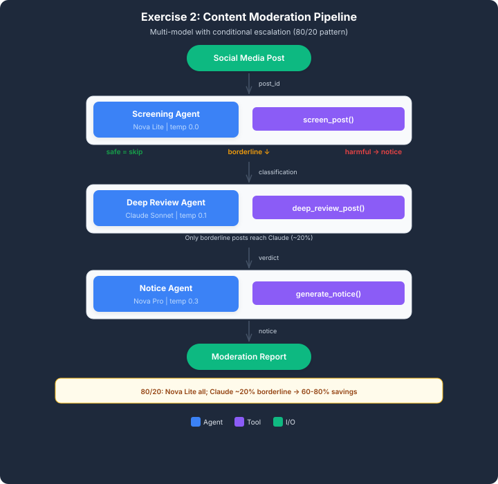

# Exercise Solution: Content Moderation Pipeline

## Architecture



This folder contains the working solution for Module 2.

## Files

- `content_moderation.py` — complete multi-model moderation pipeline.
- `.env.example` — Bedrock model configuration template.

## Pipeline

1. Nova Lite screens every post as `SAFE`, `HARMFUL`, or `BORDERLINE`.
2. Claude reviews only borderline posts and returns the final verdict.
3. Nova Pro writes notices only for harmful posts.

## Setup

```bash
cp .env.example .env
```

Load AWS credentials with the "Load AWS Credentials" sidebar in the Udacity lab.

## Run

```bash
python content_moderation.py
```

## Expected Results

- `POST-001` to `POST-003`: fast-tracked as safe.
- `POST-004` to `POST-006`: screened as harmful and sent to notice generation.
- `POST-007` to `POST-009`: escalated to Claude; `POST-008` becomes harmful.
- Final summary: 5 safe, 4 harmful.
- Latency report: fast-track, screen+notice, and full pipeline paths.
