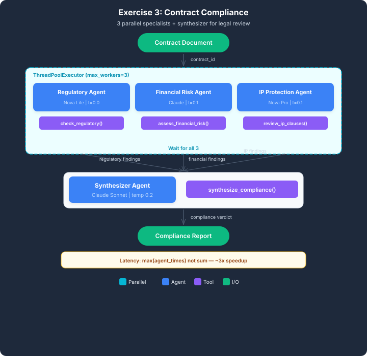

# Exercise: Parallel Contract Compliance

## Architecture



Three independent specialists review the same contract in parallel. A synthesizer then combines their findings into one compliance recommendation.

## Files

- `contract_compliance.py` — complete parallel contract compliance system.
- `.env.example` — Bedrock model configuration template.

## Agents

| Agent | Model | Role | Temperature |
|---|---|---|---:|
| RegulatoryComplianceAgent | Nova Lite | GDPR, SOX, HIPAA checks | 0.0 |
| FinancialRiskAgent | Claude | Payment terms, liability, penalties | 0.1 |
| IPProtectionAgent | Nova Pro | IP ownership, licensing, non-compete | 0.1 |
| SynthesizerAgent | Claude | Combines findings into compliance decision | 0.2 |

## Execution Flow

1. Parallel phase: `ThreadPoolExecutor(max_workers=3)` runs regulatory, financial, and IP specialists simultaneously.
2. Synthesis phase: the synthesizer reads the three caches and produces one recommendation.
3. Comparison phase: the same analysis runs sequentially to demonstrate speedup.

## Setup

```bash
cp .env.example .env
```

Load AWS credentials with the "Load AWS Credentials" sidebar in the Udacity lab.

## Run

```bash
python contract_compliance.py
```

## Expected Results

- `CONTRACT-001` vendor agreement: `APPROVE` — low risk across all dimensions.
- `CONTRACT-002` outsourcing deal: `REJECT` — high risk in regulatory, financial, and IP.
- Performance comparison shows parallel execution faster than sequential execution.
