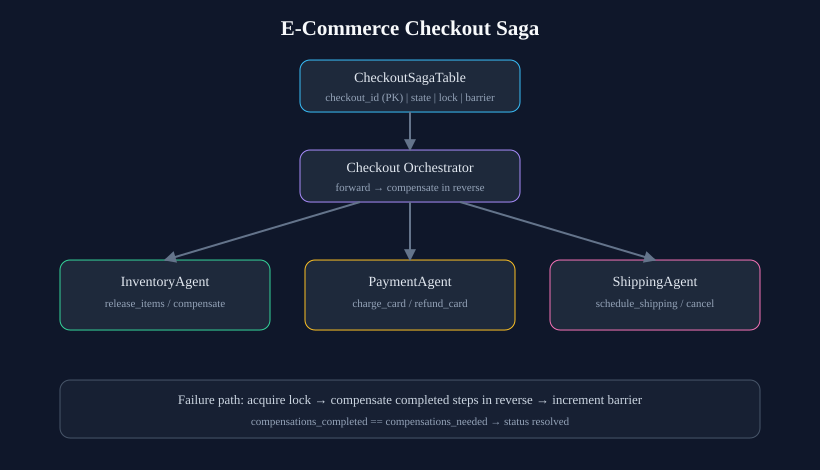

# Exercise Solution: E-Commerce Checkout Saga



## Overview

This solution implements the Saga pattern for an e-commerce checkout flow that spans three services: inventory, payment, and shipping. Each service has a forward tool and a compensating tool. When any forward step fails, the orchestrator runs compensations for previously completed steps in reverse order and tracks progress in DynamoDB.

## Architecture

- **Three service agents:** `InventoryAgent`, `PaymentAgent`, and `ShippingAgent`; each has a forward action and a compensating action.
- **Saga orchestrator:** Python controller, not LLM-driven, that runs forward execution sequentially and compensation in reverse order.
- **State machine:** DynamoDB tracks each checkout through `pending → executing → completed/failed → compensating → resolved`.
- **Distributed lock:** A conditional write prevents concurrent compensation attempts.
- **Barrier counter:** DynamoDB `ADD` increments track `compensations_completed` until every required compensation finishes.
- **TTL:** Checkout records expire automatically so resolved state machines do not accumulate indefinitely.

## Models

All agents use Amazon Nova Lite because checkout operations need speed and deterministic tool calls, not deep reasoning.

## Setup

1. Copy the env template:

   ```bash
   cp .env.example .env
   ```

2. Paste credentials from the **Load AWS Credentials** sidebar into `.env`. Never commit real credentials.

3. Deploy the DynamoDB saga-state table:

   ```bash
   aws cloudformation deploy --template-file infrastructure/stack.yaml \
       --stack-name lesson-07-exercise-saga
   ```

## Test Cases

| Checkout | Scenario | Key Behavior |
|----------|----------|--------------|
| CHK-001 | All succeed | Items released, card charged, and shipping scheduled. |
| CHK-002 | Payment fails | Inventory is released and barrier reaches `1/1`. |
| CHK-003 | Shipping fails | Payment is refunded, then inventory is released; barrier reaches `2/2`. |

## Running

```bash
python ecommerce_checkout_saga.py
```

## Cleanup

```bash
aws cloudformation delete-stack --stack-name lesson-07-exercise-saga
```

## Key Takeaways

1. **Saga pattern** — sequence of local transactions, each with a compensating action.
2. **Reverse-order compensation** — last completed step is compensated first.
3. **State machine** — DynamoDB records every step transition.
4. **Distributed lock** — conditional write prevents concurrent compensations.
5. **Idempotent compensations** — releasing items twice has the same effect as releasing once.
6. **Barrier counter** — atomic `ADD` increments gate checkout resolution on N-of-N completion.
7. **Crash recovery** — a restarted orchestrator can read state and resume from the last recorded phase.
