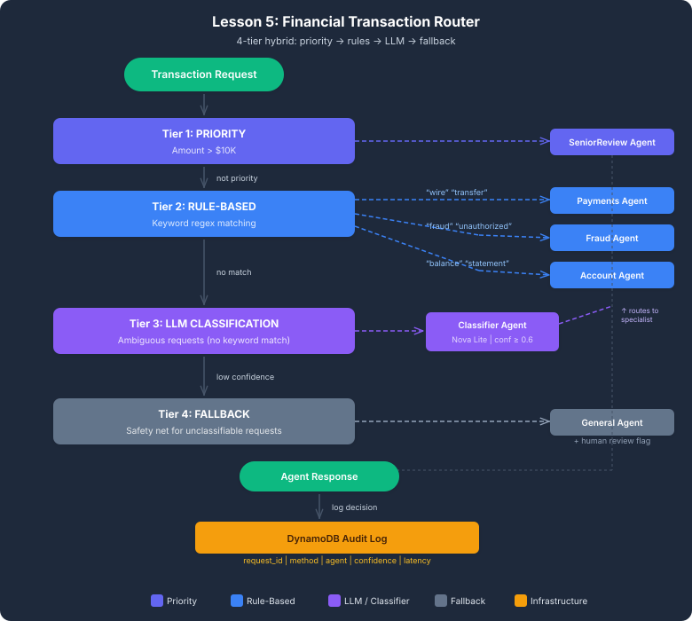

# Lesson 5 Demo: Hybrid Router for Financial Transactions

## Architecture



The dispatcher tries four tiers in order and returns the first successful match:

1. **Priority:** transactions over `$10,000` route directly to `SeniorReviewAgent`.
2. **Rules:** regex keyword matching handles predictable requests quickly and free.
3. **LLM classification:** ambiguous requests go to Nova Lite with a confidence score.
4. **Fallback:** confidence below `0.6` routes to `GeneralSupportAgent` for human review.

Every routing decision is written to DynamoDB with a 24-hour TTL.

## Setup

```bash
cp .env.example .env
```

Load AWS credentials with the "Load AWS Credentials" sidebar in the Udacity lab.

Deploy the DynamoDB audit table:

```bash
aws cloudformation deploy --template-file infrastructure/stack.yaml \
    --stack-name lesson-05-demo-routing
```

## Run

```bash
python financial_router.py
```

## Test Cases

| Requests | Expected Route | Method |
|---|---|---|
| TXN-001 to TXN-006 | PaymentsAgent / FraudAgent / AccountAgent | Rule |
| TXN-007, TXN-008 | SeniorReviewAgent | Priority |
| TXN-009 | LLM-classified agent | LLM |
| TXN-010 | GeneralSupportAgent | Fallback |

## Expected Results

- Routing accuracy: `10/10`.
- Method distribution: `6 rule`, `2 priority`, `1 llm`, `1 fallback`.
- DynamoDB audit log contains 10 entries with request ID, method, agent, confidence, and latency.

## Cleanup

```bash
aws cloudformation delete-stack --stack-name lesson-05-demo-routing
```

## Key Takeaways

1. **Rules first, LLM second** reduces classification cost and latency.
2. **Priority is an override** checked before every other strategy.
3. **Confidence thresholds** protect against weak LLM decisions.
4. **Fallback** ensures requests are never dropped.
5. **Audit logging** makes automated routing decisions reviewable.
