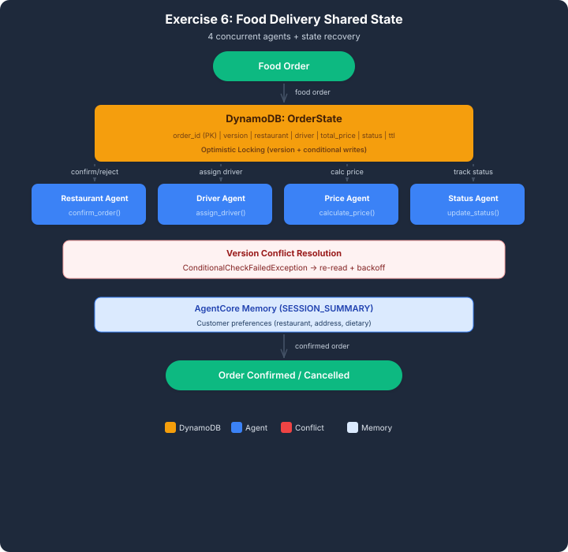

# Exercise Solution: Shared State for Food Delivery Orders



## Overview

This exercise builds a shared-state system for food delivery orders using the same optimistic-locking pattern as the ride-sharing demo, with two additions: four agents instead of three, and a state-recovery pattern that cleans up partial updates after a restaurant rejection.

## Setup

1. Copy the env template:

   ```bash
   cp .env.example .env
   ```

2. If you already deployed the stack while doing the starter (`lesson-06-exercise-shared-state`), you do not need to deploy again. Copy your starter `.env` values into this folder to point at the same resources. Otherwise:

   ```bash
   aws cloudformation deploy --template-file infrastructure/stack.yaml \
       --stack-name lesson-06-exercise-shared-state
   ```

## Architecture

- **DynamoDB:** Real `OrderState` table with optimistic locking using version-based conditional writes and a 2-hour TTL.
- **Four worker agents:** `RestaurantConfirmAgent` writes status, `DriverAssignAgent` writes driver, `PriceCalculatorAgent` writes `total_price`, and `StatusTrackerAgent` writes progress.
- **State recovery:** `recover_order()` resets driver and price to `None` and marks the order cancelled when the restaurant rejects it.
- **Cross-session memory:** `customer_memory` simulates the AgentCore Memory `SESSION_SUMMARY` strategy and remembers the preferred driver and favourite restaurant.

## Test Cases

| Order | Scenario | Key Behavior |
|-------|----------|--------------|
| ORD-001 | Sequential | Four agents run one at a time; no conflicts expected. |
| ORD-002 | Concurrent | All four agents run in parallel; version conflicts are resolved by retry. |
| ORD-003 | State recovery + memory | Driver and price write first, then the restaurant rejects; `recover_order()` cleans up. Same customer as ORD-001, so the preferred driver comes from memory. |

## Running

```bash
python food_delivery_state.py
```

## Cleanup

```bash
aws cloudformation delete-stack --stack-name lesson-06-exercise-shared-state
```

## Key Differences from Demo

- **Four agents** instead of three, giving more concurrent conflict opportunities.
- **State recovery**, a new pattern that cleans up partial writes after an upstream failure.
- **Restaurant rejection**, modelling a real-world case where one step invalidates downstream work.
- **DynamoDB plus simulated AgentCore Memory**, keeping transactional state and customer preferences in separate services.
