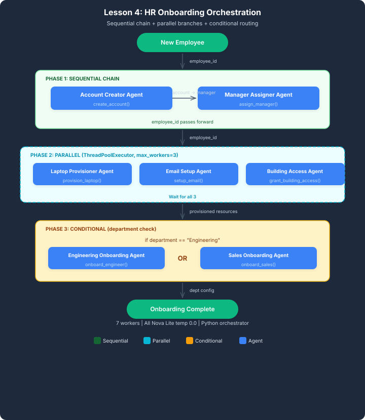

# Lesson 4: Implementing Agent Orchestration

## Architecture



A Python orchestrator manages 7 single-responsibility worker agents across three phases:

1. **Phase 1 — Sequential:** `AccountCreator → ManagerAssigner`.
2. **Phase 2 — Parallel:** `LaptopProvisioner + EmailSetup + BuildingAccess`.
3. **Phase 3 — Conditional:** `EngineeringOnboarding` OR `SalesOnboarding`, selected from the employee department field.

## Models

All 7 worker agents use Amazon Nova Lite at temperature `0.0`. The orchestrator is Python code, not an LLM.

## Test Cases

| Employee | Department | Path | Special |
|---|---|---|---|
| EMP-001 Alice Chen | Engineering | Engineering onboarding | Normal |
| EMP-002 Bob Martinez | Sales | Sales onboarding | Normal |
| EMP-003 Carol Johnson | Engineering | Engineering onboarding | Simulated laptop failure with retry |

## Setup

```bash
cp .env.example .env
```

Load AWS credentials with the "Load AWS Credentials" sidebar in the Udacity lab.

## Run

```bash
python hr_onboarding.py
```

## Expected Results

- `EMP-001` and `EMP-002` complete all three phases.
- `EMP-003` retries laptop provisioning once after a simulated transient failure.
- The summary table shows sequential, parallel, conditional, and total timings for each employee.

## Key Takeaways

1. **Sequential** — use when steps depend on earlier outputs.
2. **Parallel** — use when steps are independent.
3. **Conditional** — use when the path depends on data.
4. **Failure handling** — retry transient errors with exponential backoff.
5. **Code orchestrator** — Python controls execution; worker agents stay simple and stateless.
