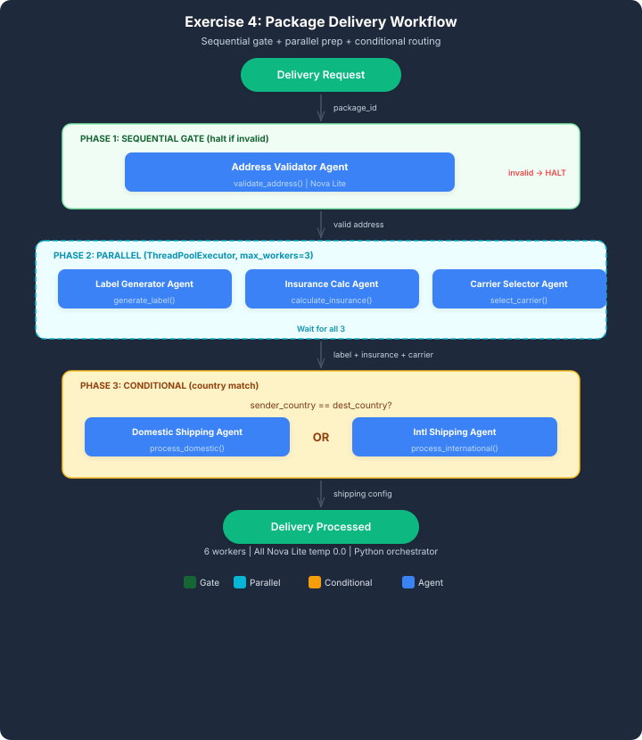

# Exercise 4: Orchestrated Package Delivery Workflow

## Architecture



A Python orchestrator manages 6 single-responsibility worker agents:

1. **Phase 1 — Sequential Gate:** `AddressValidator` must pass; otherwise the workflow halts.
2. **Phase 2 — Parallel:** `LabelGenerator + InsuranceCalculator + CarrierSelector` run simultaneously with `ThreadPoolExecutor(max_workers=3)`.
3. **Phase 3 — Conditional:** `DomesticShipping` for same-country delivery, or `InternationalShipping` with customs handling for cross-border delivery.

## Models

All 6 worker agents use Amazon Nova Lite at temperature `0.0`. The orchestrator is Python code, not an LLM.

## Test Cases

| Package | Route | Expected Result |
|---|---|---|
| PKG-001 | Domestic | US → US, USPS Priority, basic insurance |
| PKG-002 | International | US → DE, DHL International, premium insurance, customs duty |
| PKG-003 | HALTED | Empty address; gate stops workflow before any downstream agents |

## Setup

```bash
cp .env.example .env
```

Load AWS credentials with the "Load AWS Credentials" sidebar in the Udacity lab.

## Run

```bash
python delivery_workflow.py
```

## Key Differences from Demo

- **Gate pattern:** the demo uses a sequential chain where both steps always run; this exercise halts on validation failure.
- **Insurance tiers:** basic, standard, or premium based on declared value.
- **Carrier selection:** cheapest available carrier is selected automatically.
- **Customs handling:** international shipments add a customs declaration and duty estimate.
