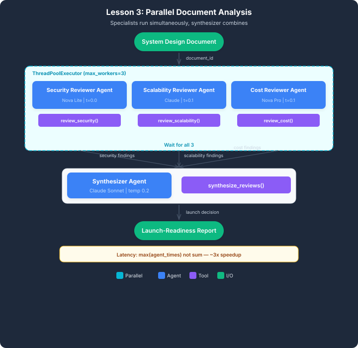

# Demo: Parallel Document Analysis

## Architecture



Three independent specialists review the same document in parallel. A synthesizer then combines their findings into a launch-readiness decision.

## Files

- `document_analysis.py` — complete parallel document analysis system.
- `.env.example` — Bedrock model configuration template.

## Agents

| Agent | Model | Role | Temperature |
|---|---|---|---:|
| SecurityReviewer | Nova Lite | Vulnerabilities, auth, encryption | 0.0 |
| ScalabilityReviewer | Claude | Bottlenecks, auto-scaling, SPOFs | 0.1 |
| CostReviewer | Nova Pro | Infrastructure costs, optimization | 0.1 |
| Synthesizer | Claude | Combines findings into launch decision | 0.2 |

## Execution Flow

1. Parallel phase: `ThreadPoolExecutor(max_workers=3)` runs the three specialists simultaneously.
2. Synthesis phase: the synthesizer reads all three caches and produces one unified report.
3. Comparison phase: the same analysis runs sequentially to show the speedup.

## Setup

```bash
cp .env.example .env
```

Load AWS credentials with the "Load AWS Credentials" sidebar in the Udacity lab.

## Run

```bash
python document_analysis.py
```

## Expected Results

- `DOC-001` e-commerce platform: `BLOCK` because of critical security issues.
- `DOC-002` internal HR portal: `APPROVE` because risk is low across all dimensions.
- Performance comparison shows parallel execution faster than sequential execution.
