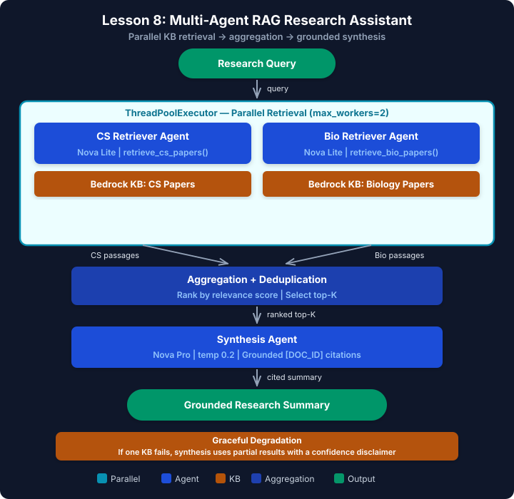

# Demo: Multi-Agent RAG for Research Assistant

## Overview



This demo implements a Multi-Agent RAG system where two specialized retriever agents each query a distinct Amazon Bedrock Knowledge Base: Computer Science papers and Biology papers. Both retrievers run in parallel using `ThreadPoolExecutor`. Their results are aggregated, ranked by relevance score, and passed to a synthesis agent that produces a grounded answer with citations.

## Architecture

- **2 retriever agents:** CS Retriever (6 CS papers), Bio Retriever (6 Bio papers).
- **Parallel retrieval:** `ThreadPoolExecutor` dispatches both retrievers simultaneously.
- **Result aggregation:** Combine results from both KBs, deduplicate by document ID, rank by score, and select top-K.
- **Synthesis agent:** Nova Pro produces a grounded summary citing `[DOC_ID]` for every claim.
- **Graceful degradation:** If one KB fails, synthesis uses partial results from the other.

## Models

- Retrievers: Amazon Nova Lite, temperature `0.0`.
- Synthesis: Amazon Nova Pro, temperature `0.2`.

## Setup

Bedrock Knowledge Bases require **us-west-2** (Oregon) or **us-east-1** (N. Virginia).

1. Copy the env template and load AWS credentials:

   ```bash
   cp .env.example .env
   ```

2. Deploy the S3 source bucket:

   ```bash
   aws cloudformation deploy --template-file infrastructure/stack.yaml \
       --stack-name lesson-08-demo-rag
   ```

3. Upload the CS and Biology documents to S3:

   ```bash
   python seed_documents.py
   ```

4. **Create the Knowledge Bases manually in the Bedrock console** (Knowledge Bases cannot be created via CloudFormation today). For each of CS Papers and Biology Papers:
   - Data source: **S3**, pointing at `s3://<bucket>/cs/` or `s3://<bucket>/bio/`.
   - Embedding model: **amazon.titan-embed-text-v2:0**.
   - Vector store: **Amazon S3 Vectors**.
   - Click **Sync** on the data source after creation so the documents are ingested.

5. Copy the two KB IDs into `CS_KB_ID` and `BIO_KB_ID` in `.env`.

## Test Cases

| Query | Scenario | Key Behavior |
|-------|----------|--------------|
| `applications of machine learning in genomics` | Cross-domain | Hits both CS and Bio KBs. |
| `CRISPR gene editing for crop improvement` | Domain-specific | Primarily hits the Bio KB. |
| `blockchain consensus mechanisms for IoT networks` | Out-of-scope | Few or no relevant passages. |

## Running

```bash
python research_assistant_rag.py
```

## Cleanup

Delete the two Knowledge Bases from the Bedrock console first, then tear down the stack:

```bash
aws cloudformation delete-stack --stack-name lesson-08-demo-rag
```

## Key Takeaways

1. **Specialized retrievers** — each agent owns exactly one Knowledge Base.
2. **Parallel retrieval** — `ThreadPoolExecutor` searches all KBs simultaneously.
3. **Relevance scoring** — passages are ranked by similarity score.
4. **Result aggregation** — combine, deduplicate, rank, and truncate to top-K.
5. **Grounded synthesis** — every factual claim cites a specific `[DOC_ID]`.
6. **Graceful handling** — out-of-scope queries and KB failures return partial or empty results honestly.
