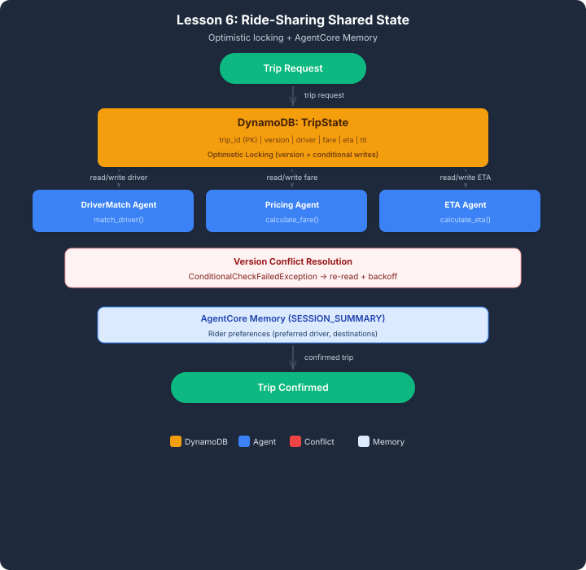

# Demo: Shared State for Ride-Sharing Trip Management



## Overview
This demo coordinates three agents—Driver Match, Pricing, and ETA—that update one shared ride record. DynamoDB provides transactional state with version-based optimistic locking, while a simulated AgentCore Memory stores rider preferences across trips.

## Architecture
- **DynamoDB:** real `trip-state` table with conditional writes through boto3.
- **Optimistic locking:** every write checks `version == expected_version`; a stale version raises `ConditionalCheckFailedException`.
- **Three worker agents:** `DriverMatchAgent`, `PricingAgent`, and `ETAAgent` each update a different field on the same trip record.
- **Conflict handling:** re-read the record, get the fresh version, and retry with exponential backoff of `0.1s`, `0.2s`, and `0.4s`.
- **Cross-session memory:** an in-memory `rider_memory` dict simulates AgentCore Memory `SESSION_SUMMARY`, remembering the preferred driver.

## Models
All agents use Amazon Nova Lite with `temperature=0.0`; state operations need speed and determinism, not open-ended reasoning.

## AWS Services Used
- Amazon Bedrock: Nova Lite agent inference.
- Amazon DynamoDB: transactional trip state and optimistic locking.
- AgentCore Memory: simulated here; production maps to the `bedrock-agentcore-control` API.

## Test Scenarios
| Trip | Scenario | Key Behavior |
|------|----------|--------------|
| `TRIP-001` | Sequential updates | No version conflicts; final state reaches `confirmed`. |
| `TRIP-002` | Concurrent updates | Three agents run in parallel via `ThreadPoolExecutor`; conflicts trigger retry. |
| `TRIP-003` | Cross-session memory | Alice returns and reuses the preferred driver stored after `TRIP-001`. |

## Running
```bash
python ride_sharing_state.py
```

## Cleanup
```bash
aws cloudformation delete-stack --stack-name lesson-06-demo-shared-state
```

## Key Takeaways
1. `version == expected_version` is the optimistic lock.
2. `ConditionalCheckFailedException` signals that another agent wrote first.
3. Retry with backoff re-reads the record and writes with the fresh version.
4. TTL expires records after one hour to avoid stale data accumulation.
5. DynamoDB owns within-session transactional state; AgentCore Memory owns cross-session preferences.
