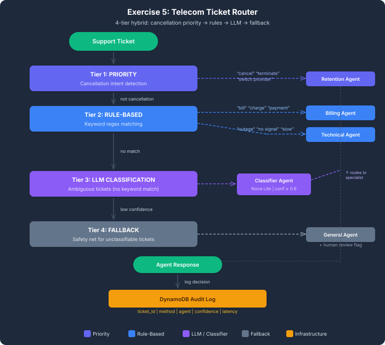

# Exercise Solution: Multi-Strategy Router for Telecom Customer Tickets



## Overview
This exercise applies the same four-strategy hybrid routing pattern from `financial_router.py` to telecom customer support. It processes 20 tickets with deterministic priority and rule checks first, then uses Nova Lite only for ambiguous cases, with a confidence-based fallback.

## Architecture
- **Priority:** cancellation intent → `RetentionAgent`
- **Rule-based:** billing keywords → `BillingAgent`; technical keywords → `TechnicalAgent`
- **LLM classification:** ambiguous tickets are classified by Nova Lite into `billing`, `technical`, `cancellation`, or `general`
- **Fallback:** low confidence → `GeneralSupportAgent` with a human-review flag
- **Audit:** every decision is written to DynamoDB with a 24-hour TTL

## Setup
1. Copy the environment template and add credentials from the “Load AWS Credentials” sidebar:
   ```bash
   cp .env.example .env
   ```
   Never commit `.env` or real credentials.

2. If the stack was already deployed for the starter (`lesson-05-exercise-routing`), reuse the same `.env` values. Otherwise, deploy the audit table:
   ```bash
   aws cloudformation deploy --template-file infrastructure/stack.yaml \
       --stack-name lesson-05-exercise-routing
   ```

## Test Coverage
| Category | Count | Percent | Method | Target |
|----------|-------|---------|--------|--------|
| Billing | 8 | 40% | Rule | `BillingAgent` |
| Technical | 6 | 30% | Rule | `TechnicalAgent` |
| Cancellation | 2 | 10% | Priority | `RetentionAgent` |
| Ambiguous | 3 | 15% | LLM | classified agent |
| Nonsensical | 1 | 5% | Fallback | `GeneralSupportAgent` |

## Running
```bash
python telecom_router.py
```

The final report shows routing accuracy, method distribution, agent distribution, and the DynamoDB audit summary.

## Cleanup
```bash
aws cloudformation delete-stack --stack-name lesson-05-exercise-routing
```

## Key Differences from Demo
- Priority trigger is cancellation intent instead of transaction amount over `$10,000`.
- The benchmark has 20 tickets instead of 10.
- Domain vocabulary is telecom billing, technical, and cancellation language.
- The smallest routing layer is the LLM, used only after cheap deterministic checks miss.
