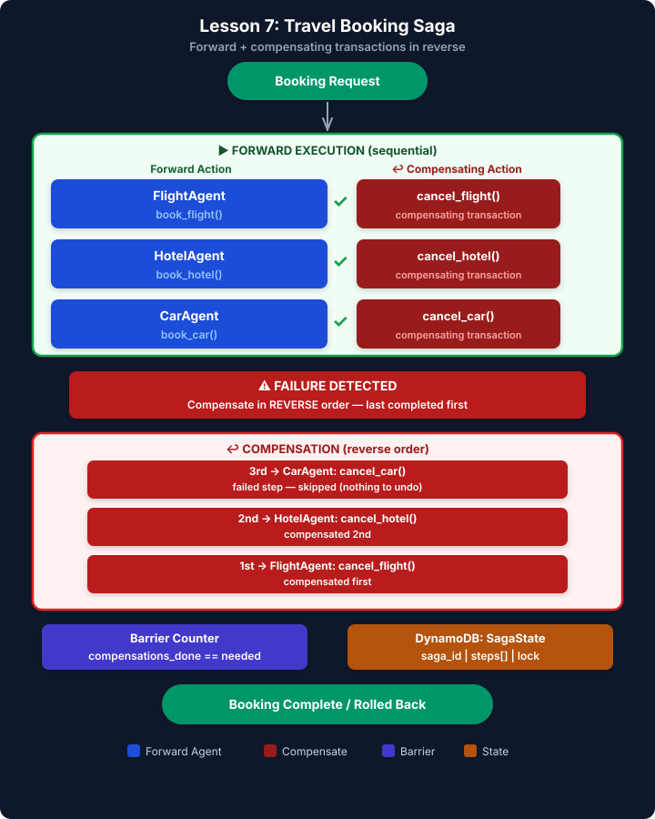

# Demo: Saga Pattern for Travel Booking



## Overview

This demo implements the Saga pattern for a travel booking system where a trip spans three independent services: flight, hotel, and car rental. If any booking fails, the saga orchestrator runs compensating transactions to undo previous successful bookings in reverse order. A DynamoDB state machine tracks each saga through its lifecycle.

## Architecture

- **Three booking agents:** `FlightAgent`, `HotelAgent`, and `CarAgent`; each has a forward `book_*` tool and a compensating `cancel_*` tool.
- **Saga orchestrator:** Python controller, not LLM-driven, that runs forward execution sequentially and compensation in reverse order.
- **State machine:** DynamoDB tracks each step as `pending → executing → completed/failed → compensating → compensated`.
- **Distributed lock:** A conditional write prevents concurrent compensation attempts.
- **Barrier counter:** DynamoDB `ADD` increments track `compensations_done` until every required compensation finishes.
- **TTL:** Saga records expire automatically so completed and failed state machines do not accumulate indefinitely.

## Models

All agents use Amazon Nova Lite because booking operations need speed and deterministic tool calls, not deep reasoning.

## Setup

1. Copy the env template:

   ```bash
   cp .env.example .env
   ```

2. Paste credentials from the **Load AWS Credentials** sidebar into `.env`. Never commit real credentials.

3. Deploy the DynamoDB saga-state table:

   ```bash
   aws cloudformation deploy --template-file infrastructure/stack.yaml \
       --stack-name lesson-07-demo-saga
   ```

## Test Cases

| Saga | Scenario | Key Behavior |
|------|----------|--------------|
| SAGA-001 | All succeed | Flight, hotel, and car are all confirmed. |
| SAGA-002 | Car fails | Hotel is cancelled, then flight, in reverse order. |
| SAGA-003 | Hotel fails | Only flight is cancelled; car never starts. |

## Running

```bash
python travel_booking_saga.py
```

## Cleanup

```bash
aws cloudformation delete-stack --stack-name lesson-07-demo-saga
```

## Key Takeaways

1. **Saga pattern** — sequence of local transactions, each with a compensating action.
2. **Reverse-order compensation** — last completed step is compensated first.
3. **State machine** — DynamoDB records every step transition.
4. **Distributed lock** — conditional write prevents concurrent compensations.
5. **Idempotent compensations** — cancelling twice has the same effect as cancelling once.
6. **Barrier counter** — atomic `ADD` increments gate saga resolution on N-of-N completion.
7. **Crash recovery** — a restarted orchestrator can read state and resume from the last recorded phase.
